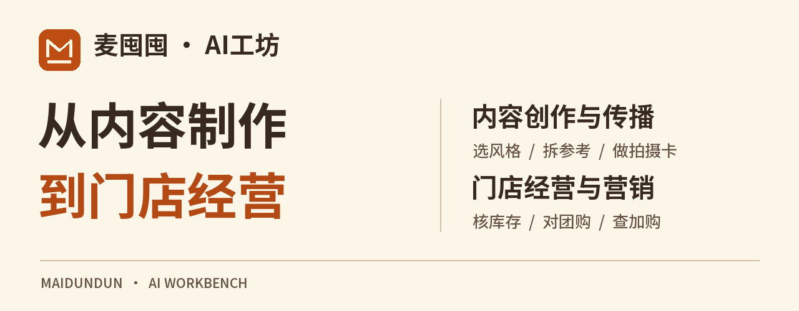

# 麦囤囤 · AI工坊

门店同事今天可能要拍一条产品视频，也可能要去冷库提货，或弄清本周卖出的团购券究竟用了多少。这里把做过的工作整理成操作卡和离线工具，每个场景都可以先看示例，再用自己的材料复做。

[门店经营与营销](docs/store-operations.md) · [English quick start](README.en.md) · [六种风格与十六种方法](docs/content-paths.md) · [爆款雷达与内容研究雷达](docs/research-radar.md)

## 从今天要做的事开始

| 你手头有什么 | 打开哪一页 |
| --- | --- |
| 门店和冷库各有一份库存表 | [提货判断与参考数量](examples/stock-pick/README.md) |
| 一份购券记录、一份核销流水 | [按事件与购券批次对账](examples/voucher-review/README.md) |
| 正准备团购、选推广视频或复盘加购 | [经营与营销操作卡](docs/store-operations.md) |
| 几款产品的实拍，想让顾客容易挑选 | [小红书实拍图文](docs/方法01-小红书实拍图文.md) |
| 一张有动作的照片，想写一句有人情味的话 | [实拍与走心文案](docs/方法03-实拍与走心文案.md) |
| 一条喜欢的参考，想知道该学哪几镜 | [参考研究](docs/research-radar.md)和[拍摄卡 Skill](skills/reference-to-shot-cards/SKILL.md) |
| 想做逐镜复刻、实拍、口播或 AI 短剧 | [六种风格的操作与验证状态](docs/content-paths.md) |

不用编程也可以用。把选中的方法卡里的提示词、自有素材和能确认的产品事实交给 AI 助手，再用同一张卡的验收项回看成品。

## 三分钟做一份拍摄卡

下载仓库 ZIP 并解压，在仓库根目录打开终端。使用 Python 3.12 或更高版本，运行下面这条命令。示例只用标准库，可离线运行。

~~~shell
python examples/shot-cards/generate.py --input examples/shot-cards/demo.json --output shot-cards-demo.html
~~~

双击生成的 HTML，在手机或电脑上查看，也可从浏览器打印。[示例输入](examples/shot-cards/demo.json) · [已生成的示例 HTML](examples/shot-cards/demo.html)。换一个主题时，复制输入文件，填自己的产品与镜头，另取一个输出文件名。

## 这个版本验证了什么

原项目有五种风格和一条来源研究链完成了更换输入的独立复做，各项媒体验证范围见方法索引。本仓库用原创示例重新验证拍摄卡工具。AI 双人对白等分支保留流程和待验证状态。阅读文档、运行示例与维护检查均无需付费模型或平台账号。

## 维护与反馈

[维护与恢复](docs/maintenance.md) · [贡献与问题反馈](CONTRIBUTING.md) · [更新记录](CHANGELOG.md)。反馈问题时请提供复现步骤及可公开的最小示例。

代码采用 [MIT](LICENSE)，原创文档与提示词采用 CC BY 4.0，品牌素材另行说明。[许可与归属](ATTRIBUTION.md)
