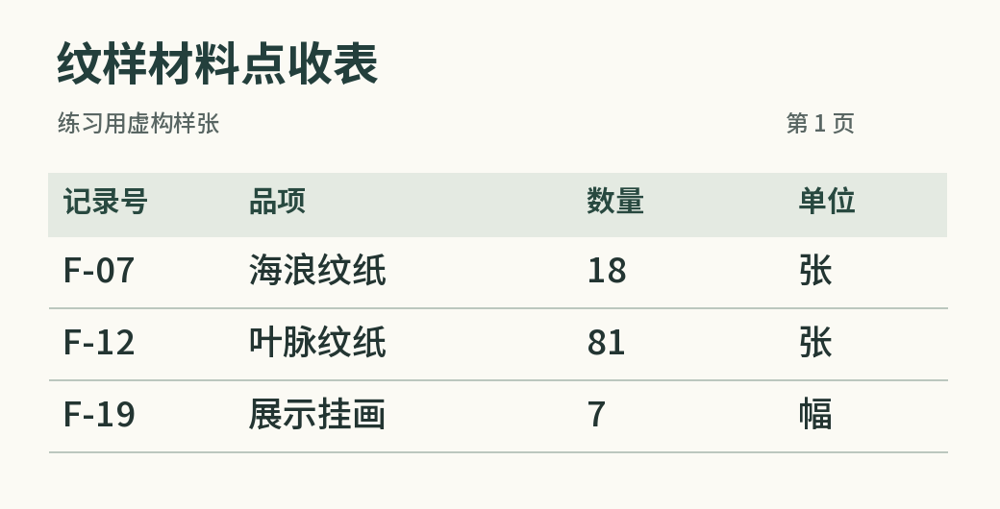

# 对着原图复核 OCR 的行、数字和单位

当识别结果要进入表格或下一道计算时，把页码和每行的位置留到复核结束。这个练习使用原创虚构图表和一份刻意写错的识别稿，浏览器即可操作。

## 先找三处差异

先放大[原图](../assets/ocr-practice.png)。以下是待核稿；建议用纸盖住下方答案后自己核一次。

| 原图位置 | 记录号 | 品项 | 待核数量 | 待核单位 |
| --- | --- | --- | ---: | --- |
| 第 1 页，上行 | F-07 | 海浪纹纸 | 81 | 张 |
| 第 1 页，中行 | F-12 | 叶脉纹纸 | 18 | 张 |
| 第 1 页，下行 | F-19 | 展示挂画 | 7 | 张 |

1. 在图像查看器里看完整一页，按**记录号**标出三行。保留原图与原始识别稿，将修订写进新表。
2. 对每一行，从左至右核对“记录号、品项、数值、单位”。记录行的位置；遇到多栏或分页，再记栏号和原图区域。看不清的单元格写“待核”，在汇总前排除。
3. 逐项相比。上行应从 81 改为 **18 张**；中行应从 18 改为 **81 张**；下行数值 7 正确，单位应改为 **幅**。前两行无论是否错位，合计都是 99 张，所以只核总数会漏掉两处错误。最终汇总应分单位列为 **99 张、7 幅**。
4. 让复核者只拿原图与新表，从每个纠正值反查对应行。若移动过行序，用记录号重新定位；若原图本身模糊，保留待核项并补取清晰图。

**换输入练习。** 在待核稿的副本中把行序倒过来，并暂时删掉 F-12。正确处理是给 F-12 标“原图有、识别稿缺行”，再从中行补回；F-19 仍按记录号核单位。找不到原图时把缺项留给人工，避免依据合计倒推原值。

**可交给 AI 的提示词。** “给你一张虚构原图和一份待核文本。按页、行、记录号对齐，分别列原读数、纠正值、单位和理由。只用能在原图定位的内容；模糊项列待核，跨单位分开汇总。”实际办公使用自行选定的 OCR 工具和已获授权的素材，公开练习不调用识别服务。
